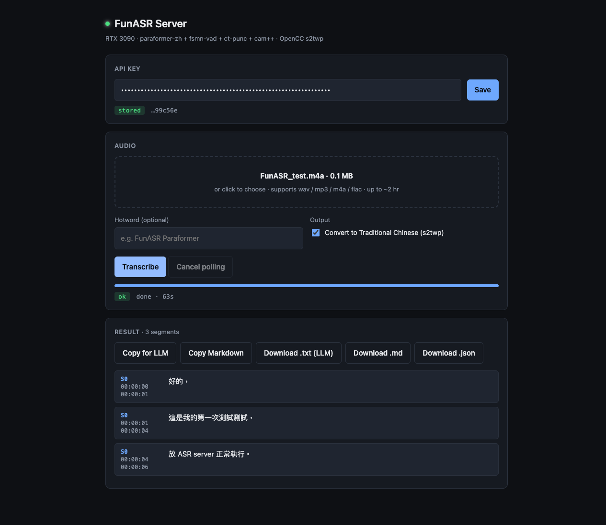

# funasr-server

A self-hosted meeting-transcription HTTP service powered by [FunASR][funasr].
Single-GPU, single-user oriented; designed for personal or small-team use to
turn 1–2 hour meeting recordings into speaker-labeled, time-stamped transcripts
that feed cleanly into an LLM for summarization.

> **Status:** v0.1 · works end-to-end · single user · battle-tested only on RTX 3090.

[funasr]: https://github.com/modelscope/FunASR

<p align="center">
  
</p>

## Highlights

- **Speaker diarization** out of the box (FunASR `cam++`).
- **Traditional Chinese** post-processing via OpenCC `s2twp` (Taiwan phrase variant), toggleable per-request.
- **LLM-optimized output**: same-speaker turns merged, coarse `MM:SS` anchors only — ~80% fewer framing tokens vs. line-per-segment markdown.
- **Web UI** included (single HTML file, no build step). Drag-drop, polling, copy/download. Works from any browser.
- **Bearer-token auth**, optional. Pluggable behind Cloudflare Access for SSO.

## Pipeline

```
audio ─► VAD ─► ASR ─► Punctuation ─► Speaker labeling ─► OpenCC s2twp ─► output
        fsmn-vad paraformer-zh  ct-punc        cam++         (server-side
                                                              post-process)
```

| Stage | FunASR alias | Resolved ModelScope ID | Disk |
|---|---|---|---|
| Voice Activity Detection | `fsmn-vad` | `iic/speech_fsmn_vad_zh-cn-16k-common-pytorch` | ~4 MB |
| Automatic Speech Recognition | `paraformer-zh` | `iic/speech_seaco_paraformer_large_asr_nat-zh-cn-16k-common-vocab8404-pytorch` (SeACo-Paraformer-large with built-in hotword support) | ~950 MB |
| Punctuation Restoration | `ct-punc` | `iic/punc_ct-transformer_cn-en-common-vocab471067-large` | ~1.2 GB |
| Speaker Diarization | `cam++` | `iic/speech_campplus_sv_zh-cn_16k-common` | ~28 MB |
| Simplified → Traditional | — | OpenCC `s2twp` (server post-process) | n/a |

The four FunASR models are loaded once into GPU memory by `pipeline.py` and
reused across all jobs. The `paraformer-zh` alias actually resolves to
**SeACo-Paraformer-large** under the hood — that's why the `hotword` request
parameter works.

OpenCC conversion happens in Python after FunASR returns, before the
result is stored. It can be disabled per-request with `?traditional=false`
(the API call) or by unticking the box in the web UI.

## Hardware Requirements

- NVIDIA GPU with **≥8 GB VRAM** (tested on RTX 3090 / 24 GB).
- ~5 GB free disk for the model cache (`~/.cache/modelscope/`).
- Linux or **WSL2 with CUDA** driver. Non-CUDA setups will fall back to CPU but are not the target.

## Quick Start

```bash
# 1. Install uv (https://docs.astral.sh/uv/)
curl -LsSf https://astral.sh/uv/install.sh | sh

# 2. Clone and enter
git clone https://github.com/poterpan/asr-server.git
cd asr-server/server

# 3. Configure
cp .env.example .env
echo "FUNASR_API_KEY=$(openssl rand -hex 32)" >> .env
chmod 600 .env

# 4. Install Python + deps (uv handles both)
uv sync

# 5. (Optional, recommended on first run) verify CUDA + model load
uv run python test_smoke.py     # downloads ~1 GB of models the first time

# 6. Run
set -a; . ./.env; set +a
uv run uvicorn server:app --host 127.0.0.1 --port 8920
```

Open `http://127.0.0.1:8920/` in a browser, paste your `FUNASR_API_KEY` into
the UI, drop in an audio file, done.

## Output Formats

The server returns three flavors of the same job result, picked via
`?format=<x>` on `/jobs/<id>/result`:

| Format | Use case | Sample |
|---|---|---|
| `json` (default) | Programmatic consumption | `[{speaker, start, end, text}, ...]` |
| `md`             | Human review, archive    | One markdown bullet per ASR segment with full timestamps |
| `llm`            | Feed into LLMs           | Same-speaker turns merged, `[Speaker N · MM:SS]` headers, no per-sentence timestamps |

`llm` is what you want for "summarize this meeting" prompts. See
[`docs/output-formats.md`](docs/) for token-cost comparison.

## API

| Method | Path | Description |
|---|---|---|
| `GET`  | `/health` | Liveness probe (no auth). |
| `POST` | `/transcribe` | Multipart upload. Form fields: `file` (required), `hotword` (str, optional), `traditional` (bool, default `true`). Returns `{job_id}`. |
| `GET`  | `/jobs/{id}` | Job status + metadata. |
| `GET`  | `/jobs/{id}/result?format=json\|md\|llm` | Result in the chosen format. |
| `GET`  | `/` | Web UI. |
| `GET`  | `/static/*` | Web UI assets. |

All endpoints except `/health` and `/` require `Authorization: Bearer <FUNASR_API_KEY>` when a key is set.

## Deployment

| Scenario | Guide |
|---|---|
| Single host, LAN-only | [docs/deployment-bare.md](docs/deployment-bare.md) |
| Public access with HTTPS + SSO via Cloudflare Tunnel + Access | [docs/deployment-cloudflared.md](docs/deployment-cloudflared.md) |
| systemd unit template | [docs/funasr-server.service](docs/funasr-server.service) |

## Repository Layout

```
asr-server/
├── LICENSE
├── README.md            # ← you are here
├── CHANGELOG.md
├── .env.example         # symlinked to server/.env.example for convenience
├── docs/
│   ├── deployment-bare.md
│   ├── deployment-cloudflared.md
│   └── funasr-server.service
└── server/              # the deployed unit
    ├── pyproject.toml
    ├── uv.lock
    ├── pipeline.py      # FunASR AutoModel wrapper + OpenCC + format helpers
    ├── server.py        # FastAPI front-end
    ├── test_smoke.py
    ├── .env.example
    └── static/
        └── index.html   # vanilla-JS web UI, no build
```

The `server/` subfolder is the entire runtime; `docs/` and meta files live at
the repo root. Future client-side reference implementations (CLI, mobile, etc.)
would land alongside `server/`.

## Development

```bash
# from the server/ directory
uv sync
uv run python test_smoke.py     # smoke test
uv run uvicorn server:app --reload --host 127.0.0.1 --port 8920
```

There are no linting / formatting configs shipped — code style is whatever
your editor + `ruff` defaults give you. PRs welcome to add `ruff.toml` if you
want to standardize.

## Configuration Reference

All settings via env vars (read by `server/server.py`):

| Var | Default | Effect |
|---|---|---|
| `FUNASR_API_KEY` | (unset) | Bearer token. **If unset and bound to non-loopback, the server logs a prominent warning at startup.** |
| `FUNASR_LOG_LEVEL` | `INFO` | Python logging level. |
| `FUNASR_OUTPUT_DIR` | `./outputs` | Reserved scratch dir. |

## Security Notes

- The web UI page itself is unauthenticated; the user pastes their API key in
  the browser, which stores it in `localStorage`. **The key never leaks to the
  server's static assets.**
- For exposure beyond a single trusted network, prefer the Cloudflare Tunnel +
  Access path — it adds proper SSO and HTTPS without touching the server.
- `navigator.clipboard.writeText` requires a secure context. On plain-HTTP
  deployments (`http://192.168.x.x:8920`) the "Copy" buttons silently fail and
  the UI shows `clipboard blocked`. Switch to HTTPS to fix.

## License

[MIT](LICENSE).

## Acknowledgements

- [FunASR][funasr] (Alibaba ModelScope) — the actual ASR magic.
- OpenCC (via [opencc-python-reimplemented](https://github.com/yichen0831/opencc-python)) for Simplified→Traditional conversion.
